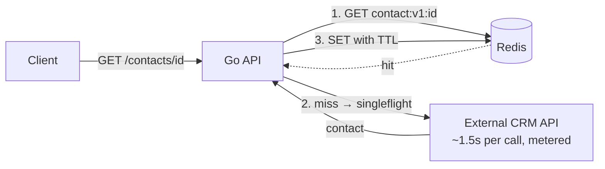

# go-redis-cache-benchmark

> **What happens when every request to your API depends on a slow, metered external API?**
> This project shows — with real, reproducible numbers — how a Redis cache-aside layer in Go turned a **1.66s average response into 2.9ms** and cut external API calls by **84.5%**.


---

## 📌 The problem

In messaging platforms, a single conversation can trigger the same lookup dozens of times: *"who is this contact? which segment? did they opt in?"*. When that data lives in an **external API** that takes ~1.5s per call and **charges per request**, two things happen:

- 🐢 **Latency**: every user-facing request inherits the external API's slowness.
- 💸 **Cost**: the same contact is fetched — and paid for — again and again.

I faced this in production, where a Redis caching layer I implemented **cut critical request times from 14s to 2s**. This repository is an **independent, from-scratch reproduction** of that pattern, so anyone can run it and see the numbers.

## 🧠 The solution

A Go API that serves `GET /contacts/{id}` using the **cache-aside** pattern:

1. **Look up Redis first.** On a hit, return in milliseconds.
2. **On a miss, call the external API — only once per key.** [`singleflight`](https://pkg.go.dev/golang.org/x/sync/singleflight) collapses concurrent misses for the same contact into a single upstream call, preventing a **cache stampede**.
3. **Store the result with a TTL**, so data refreshes over time.
4. **Degrade gracefully.** If Redis is down, the API keeps serving from the external API instead of failing.

## 🏗️ Architecture



```
cmd/
  api/        HTTP API (cache-aside + singleflight)
  upstream/   simulated slow, metered external API
  bench/      load generator: latency percentiles + upstream call count
internal/
  contacts/   domain + service (the core logic, fully unit-tested)
  cache/      Cache interface + Redis implementation
  upstream/   HTTP client for the external API
  metrics/    lock-free counters exposed at /metrics
```

## 🧰 Tech stack

- **Go 1.24** — `net/http` (method-based routing), `log/slog`, `sync/atomic`
- **Redis 7** with [`go-redis/v9`](https://github.com/redis/go-redis)
- **golang.org/x/sync/singleflight** — request coalescing
- **Docker / Docker Compose**

## 📊 Measurable results

Benchmark: **2,000 requests, 50 concurrent clients, 500 distinct contacts** following a Zipf distribution (a few "hot" contacts are requested very often — the realistic pattern of active conversations). External API latency: 1.5s + up to 300ms jitter.

| Scenario | Avg latency | p50 | p95 | Throughput | External API calls |
|---|---:|---:|---:|---:|---:|
| ❌ No cache | 1.656s | 1.657s | 1.788s | 29.8 req/s | 2,000 (100%) |
| ✅ Redis, cold start | 312ms | 0.5ms | 1.728s | 148.7 req/s | 310 (15.5%) |
| 🚀 Redis, warm | **2.9ms** | **2.5ms** | **6ms** | **15,518 req/s** | **0 (0%)** |

**Takeaways**
- ⚡ Average latency dropped **from 1.66s to 2.9ms** once the cache was warm (~570x faster).
- 💸 Even from a **cold start**, external API calls fell by **84.5%** — that's 84.5% of the bill gone.
- 🛡️ `singleflight` coalesced **201 concurrent requests** that would otherwise have hit the external API at the same time.
- 📈 Throughput went **from 30 to ~150 req/s** cold, and over **15k req/s** warm.

> Numbers measured on a single Linux machine with Redis running locally. Your numbers will vary — run `make bench` and see for yourself.

## ▶️ How to run locally

**With Docker (recommended)**

```bash
docker compose up -d --build
go run ./cmd/bench -n 2000 -c 50 -keys 500
curl localhost:8080/metrics
```

**Without Docker** (needs a local Redis on `:6379`)

```bash
make build
./bin/upstream &
./bin/api -cache=true &      # use -cache=false to compare
./bin/bench -n 2000 -c 50 -keys 500
```

**Tests** (includes a stampede test: 100 concurrent misses → exactly 1 upstream call)

```bash
make test
```

**Endpoints**

| Method | Path | Description |
|---|---|---|
| GET | `/contacts/{id}` | Contact profile (cached) |
| GET | `/metrics` | Hits, misses, hit ratio, upstream calls, coalesced requests |
| GET | `/healthz` | Liveness check |

## ⚖️ Trade-offs and limitations

Caching is not free. These are the decisions I made — and what they cost:

- 🔴 **Stale data.** A contact updated in the external API may be served from cache until the TTL (5 min) expires. Fine for profile data; *not* fine for balances or stock. A production system could add **event-driven invalidation** (e.g. a Kafka event on contact update deletes the key).
- 🔴 **Cold start still hurts.** The first request for each key pays full latency (see p95 in the cold run). **Cache warming** for known hot keys would help.
- 🔴 **singleflight is per instance.** With N API replicas, up to N upstream calls can happen for the same key. A **distributed lock** in Redis (`SET NX`) would make it global, at the cost of extra complexity.
- 🔴 **Errors are not cached.** That protects correctness but means a failing upstream is retried on every miss. **Negative caching** with a short TTL, plus a **circuit breaker**, would protect the external API during outages.
- 🔴 **Memory.** Every cached contact costs Redis memory. Use `maxmemory` + an eviction policy (`allkeys-lru`) in production.
- ✅ **Graceful degradation.** If Redis goes down, latency goes back to "no cache" levels — but the API **stays up**.

## 🗺️ Next steps

- [ ] Event-driven invalidation via Kafka
- [ ] Distributed singleflight with Redis locks
- [ ] Prometheus metrics + Grafana dashboard
- [ ] Circuit breaker around the external API

---

Built by **Victor Hisamitsu** — Backend Software Engineer (Go • Kafka • Redis).
[LinkedIn](https://www.linkedin.com/in/victor-hisamitsu-1b985a237/)
