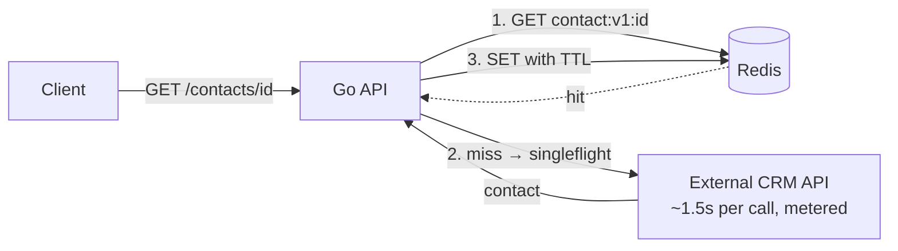
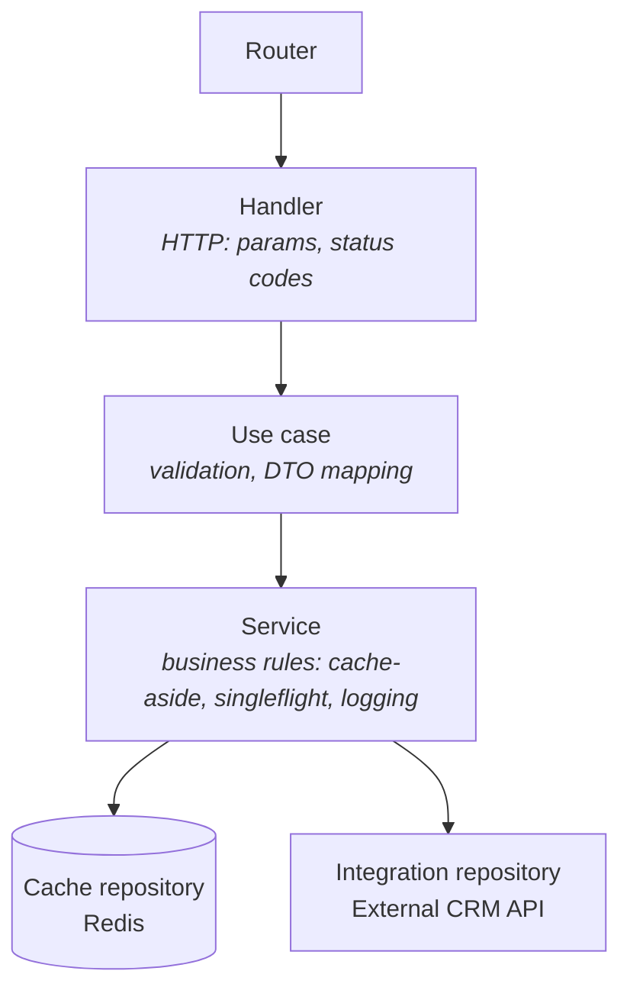

# go-redis-cache-benchmark

> **What happens when every request to your API depends on a slow, metered external API?**
> This project shows — with real, reproducible numbers — how a Redis cache-aside layer in Go turned a **1.66s average response into 2.9ms** and cut external API calls by **84.5%**.


---

## 📌 The problem

In messaging platforms, a single conversation can trigger the same lookup dozens of times: *"who is this contact? which segment? did they opt in?"*. When that data lives in an **external API** that takes ~1.5s per call and **charges per request**, two things happen:

- 🐢 **Latency**: every user-facing request inherits the external API's slowness.
- 💸 **Cost**: the same contact is fetched — and paid for — again and again.

I faced this in production, where a Redis caching layer I implemented **cut critical request times from 14s to 2s**. This repository is an **independent, from-scratch reproduction** of that pattern, so anyone can run it and see the numbers.

## 🧠 The solution

A Go API that serves `GET /contacts/{id}` using the **cache-aside** pattern:

1. **Look up Redis first.** On a hit, return in milliseconds.
2. **On a miss, call the external API — only once per key.** [`singleflight`](https://pkg.go.dev/golang.org/x/sync/singleflight) collapses concurrent misses for the same contact into a single upstream call, preventing a **cache stampede**.
3. **Store the result with a TTL**, so data refreshes over time.
4. **Degrade gracefully.** If Redis is down, the API keeps serving from the external API instead of failing.

## 🏗️ Architecture



### Layered design

The code follows a **layered architecture**: each layer has one job and depends only on the layer below it, through **interfaces**. That makes every layer testable in isolation and lets the cache or the CRM client be swapped without touching business rules.



| Layer | Responsibility | Knows about |
|---|---|---|
| **Router** | Maps routes to handlers | Handlers |
| **Handler** | Reads HTTP input, translates domain errors into status codes (400 / 404 / 502) | Use case interface, DTOs |
| **Use case** | Validates input, orchestrates the workflow, maps the domain model to the response DTO | Service interface |
| **Service** | Business rules: cache-aside, singleflight, graceful degradation, structured logs | Repository interfaces, domain model |
| **Repositories** | Talk to the outside world: Redis (`cache`) and the CRM API (`integration`) | Infrastructure only |

Interfaces are declared **where they are consumed** (the service declares `ContactCache` and `ContactProvider`), the idiomatic Go approach that keeps dependencies pointing inward.

```
cmd/
  api/            composition root: wires dependencies, no business logic
  upstream/       simulated slow, metered external CRM
  bench/          load generator: latency percentiles + upstream call count
internal/
  app/contact/
    controller/
      router.go   route registration
      handler/    HTTP handlers
      usecase/    application workflows (GetContact)
      dto/        request/response contracts
    domain/
      model/      Contact entity + domain errors
      service/    business rules + logging
    repository/
      cache/        Redis repository (key naming, serialization, TTL)
      integration/  HTTP client for the external CRM
  crosscutting/
    config/       env-based configuration (12-factor)
    logger/       structured JSON logging (log/slog)
    metrics/      lock-free counters exposed at /metrics
    httpx/        shared HTTP helpers
```

## 🧰 Tech stack

- **Go 1.24** — `net/http` (method-based routing), `log/slog` (structured logs), `sync/atomic`
- **Layered architecture** — router → handler → use case → service → repository
- **Redis 7** with [`go-redis/v9`](https://github.com/redis/go-redis)
- **golang.org/x/sync/singleflight** — request coalescing
- **Docker / Docker Compose**

## 📊 Measurable results

Benchmark: **2,000 requests, 50 concurrent clients, 500 distinct contacts** following a Zipf distribution (a few "hot" contacts are requested very often — the realistic pattern of active conversations). External API latency: 1.5s + up to 300ms jitter.

| Scenario | Avg latency | p50 | p95 | Throughput | External API calls |
|---|---:|---:|---:|---:|---:|
| ❌ No cache | 1.656s | 1.657s | 1.788s | 29.8 req/s | 2,000 (100%) |
| ✅ Redis, cold start | 312ms | 0.5ms | 1.728s | 148.7 req/s | 310 (15.5%) |
| 🚀 Redis, warm | **2.9ms** | **2.5ms** | **6ms** | **15,518 req/s** | **0 (0%)** |

**Takeaways**
- ⚡ Average latency dropped **from 1.66s to 2.9ms** once the cache was warm (~570x faster).
- 💸 Even from a **cold start**, external API calls fell by **84.5%** — that's 84.5% of the bill gone.
- 🛡️ `singleflight` coalesced **201 concurrent requests** that would otherwise have hit the external API at the same time.
- 📈 Throughput went **from 30 to ~150 req/s** cold, and over **15k req/s** warm.

> Numbers measured on a single Linux machine with Redis running locally. Your numbers will vary — see [How to run locally](#️-how-to-run-locally) and try it yourself.

## ▶️ How to run locally

You can test everything in about 2 minutes. Pick **one** of the options below.

### Prerequisites

| Option | You need |
|---|---|
| A — Docker only (easiest) | [Docker](https://docs.docker.com/get-docker/) with Docker Compose |
| B — Go + Docker | Docker + [Go 1.24+](https://go.dev/dl/) |
| C — No Docker | Go 1.24+ and a local [Redis](https://redis.io/docs/latest/operate/oss_and_stack/install/) on port `6379` |

### 1. Clone the repository

```bash
git clone https://github.com/victorhisamitsu/go-redis-cache-benchmark.git
cd go-redis-cache-benchmark
```

### Option A — Docker only (no Go installation needed)

**Start the stack** (Redis + simulated external API + Go API):

```bash
docker compose up -d --build
```

**Check that it works** — the first call takes ~1.5s (cache miss), the second one is instant (cache hit):

```bash
curl localhost:8080/contacts/42
curl localhost:8080/contacts/42
```

**Run the benchmark with the cache ON:**

```bash
docker compose run --rm bench
```

**Now compare with the cache OFF:**

```bash
CACHE_ENABLED=false docker compose up -d api
docker compose run --rm bench
```

> On Windows PowerShell, use `$env:CACHE_ENABLED="false"; docker compose up -d api` instead.

**See the counters** (hits, misses, hit ratio, upstream calls, coalesced requests):

```bash
curl localhost:8080/metrics
```

**Stop everything:**

```bash
docker compose down
```

### Option B — Go + Docker

```bash
docker compose up -d --build
go run ./cmd/bench -n 2000 -c 50 -keys 500
```

### Option C — Without Docker

Start Redis locally, then run each service in its own terminal:

```bash
go run ./cmd/upstream                  # terminal 1 — simulated external API on :8081
go run ./cmd/api -cache=true           # terminal 2 — API on :8080 (use -cache=false to compare)
go run ./cmd/bench -n 2000 -c 50       # terminal 3 — benchmark
```

### Benchmark options

| Flag | Default | Meaning |
|---|---|---|
| `-n` | `2000` | total requests |
| `-c` | `50` | concurrent clients |
| `-keys` | `500` | distinct contact ids (Zipf distribution) |

Example: `docker compose run --rm bench -n 5000 -c 100 -keys 1000`

> 💡 Tip: run the benchmark **twice** with the cache ON — the first run starts with a cold cache, the second one shows the warm-cache numbers.

### Run the tests

```bash
go test -race ./...
```

Each layer is tested in isolation with fakes:

| Layer | What is tested |
|---|---|
| Handler | Domain errors → HTTP status codes (200 / 400 / 404 / 502) |
| Use case | Input validation (rejects ids like `../etc/passwd`), DTO mapping |
| Service | Cache hit/miss, **cache stampede** (100 concurrent misses → exactly 1 external call), Redis down → graceful fallback, errors never cached |
| Cache repository | Integration test against a real Redis (skipped automatically if Redis is not running) |

### Endpoints

| Method | Path | Description |
|---|---|---|
| GET | `/contacts/{id}` | Contact profile (cached) |
| GET | `/metrics` | Hits, misses, hit ratio, upstream calls, coalesced requests |
| GET | `/healthz` | Liveness check |

### Configuration

| Variable | Default | Description |
|---|---|---|
| `CACHE_ENABLED` | `true` | Turn the Redis cache on/off |
| `REDIS_ADDR` | `localhost:6379` | Redis address |
| `UPSTREAM_URL` | `http://localhost:8081` | External API base URL |
| `CACHE_TTL` | `5m` | How long a contact stays cached |
| `LOG_LEVEL` | `info` | `debug` shows every cache hit/miss |
| `UPSTREAM_LATENCY` | `1500ms` | Simulated latency of the external API |
| `UPSTREAM_JITTER` | `300ms` | Random extra latency |

## ⚖️ Trade-offs and limitations

Caching is not free. These are the decisions I made — and what they cost:

- 🔴 **Stale data.** A contact updated in the external API may be served from cache until the TTL (5 min) expires. Fine for profile data; *not* fine for balances or stock. A production system could add **event-driven invalidation** (e.g. a Kafka event on contact update deletes the key).
- 🔴 **Cold start still hurts.** The first request for each key pays full latency (see p95 in the cold run). **Cache warming** for known hot keys would help.
- 🔴 **singleflight is per instance.** With N API replicas, up to N upstream calls can happen for the same key. A **distributed lock** in Redis (`SET NX`) would make it global, at the cost of extra complexity.
- 🔴 **Errors are not cached.** That protects correctness but means a failing upstream is retried on every miss. **Negative caching** with a short TTL, plus a **circuit breaker**, would protect the external API during outages.
- 🔴 **Memory.** Every cached contact costs Redis memory. Use `maxmemory` + an eviction policy (`allkeys-lru`) in production.
- ✅ **Graceful degradation.** If Redis goes down, latency goes back to "no cache" levels — but the API **stays up**.

## 🗺️ Next steps

- [ ] Event-driven invalidation via Kafka
- [ ] Distributed singleflight with Redis locks
- [ ] Prometheus metrics + Grafana dashboard
- [ ] Circuit breaker around the external API

---

Built by **Victor Hisamitsu** — Backend Software Engineer (Go • Kafka • Redis).
[LinkedIn](https://www.linkedin.com/in/victor-hisamitsu-1b985a237/)
